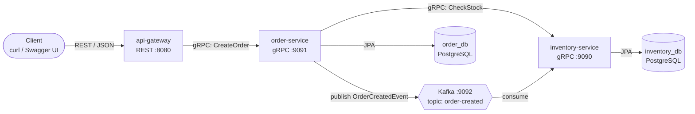
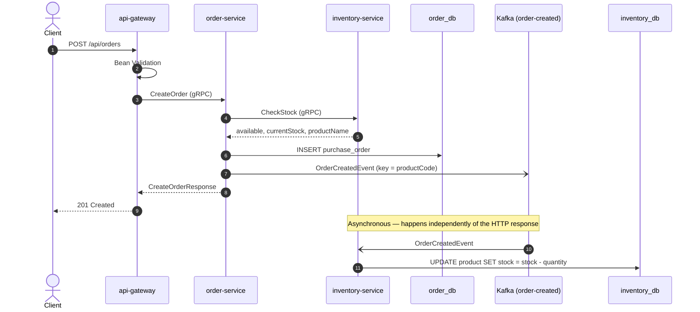

# Order & Inventory Microservices — Kafka + gRPC Case Study

A hands-on microservices case study built with **Spring Boot 4.1**, **Kotlin**, **gRPC**, **Apache Kafka**, and **PostgreSQL**.

The goal of this project is to learn how event-driven communication with Apache Kafka works in practice, alongside synchronous service-to-service calls with gRPC. The domain is intentionally simple — placing an order for a product and deducting its stock — so the focus stays on the architecture and the messaging patterns.


-231F20?logo=apachekafka&logoColor=white)


---

## Table of Contents

- [Architecture](#architecture)
- [Request Flow](#request-flow)
- [Services](#services)
- [Tech Stack](#tech-stack)
- [Project Structure](#project-structure)
- [Communication Contracts](#communication-contracts)
    - [gRPC](#grpc)
    - [Kafka Event](#kafka-event)
- [Database Schema](#database-schema)
- [Getting Started](#getting-started)
- [REST API](#rest-api)
- [Testing the System](#testing-the-system)
- [Observing Kafka](#observing-kafka)
- [Design Decisions](#design-decisions)
- [Known Limitations](#known-limitations)
- [Roadmap](#roadmap)

---

## Architecture



The system combines two communication styles, each used where it fits best:

| Style | Technology | Used for | Why |
|---|---|---|---|
| **Synchronous** | gRPC | Asking a question that needs an answer *now* — "is there enough stock?" | The caller cannot continue without the answer. |
| **Asynchronous** | Kafka | Announcing that something *has happened* — "an order was created" | The publisher does not need to wait; consumers react in their own time, even if they were offline when the event was published. |

Each service owns its own database (**database-per-service**). No service reads another service's tables — if it needs data, it asks through gRPC or listens to events.

---

## Request Flow



1. The client sends a REST request to the **api-gateway**, the only public entry point.
2. The gateway validates the request and forwards it to **order-service** over gRPC.
3. **order-service** asks **inventory-service** over gRPC whether there is enough stock.
4. If there is, **order-service** saves the order to `order_db`.
5. **order-service** publishes an `OrderCreatedEvent` to Kafka and immediately responds — it does **not** wait for the stock to be deducted.
6. **inventory-service**, subscribed to the `order-created` topic, receives the event and deducts the stock in `inventory_db`.

---

## Services

| Service | Port | Role | Database | Talks to |
|---|---|---|---|---|
| **api-gateway** | `8080` (HTTP) | Public REST entry point. Validates input, translates REST ⇄ gRPC, maps gRPC errors to HTTP status codes. | — | order-service (gRPC client) |
| **order-service** | `9091` (gRPC) | Creates orders. Checks stock, persists the order, publishes `OrderCreatedEvent`. | `order_db` | inventory-service (gRPC client), Kafka (producer) |
| **inventory-service** | `9090` (gRPC) | Owns products and stock. Answers stock checks, consumes `OrderCreatedEvent` to deduct stock. | `inventory_db` | Kafka (consumer) |
| **Kafka** | `9092` | Event broker, single node in KRaft mode (no ZooKeeper). | — | — |
| **PostgreSQL** | `5433` | One server, two separate databases. | — | — |

---

## Tech Stack

| Category | Technology |
|---|---|
| Language | Kotlin 2.3.21 on JDK 25 |
| Framework | Spring Boot 4.1.0 |
| Build | Gradle (Kotlin DSL), one independent Gradle project per service |
| Sync communication | gRPC via Spring Boot's built-in Spring gRPC 1.1.0 starters (`spring-boot-starter-grpc-server` / `-client`) |
| Contracts | Protocol Buffers 3, generated with the `com.google.protobuf` Gradle plugin |
| Async communication | Apache Kafka 4.3.1 (KRaft) + Spring for Apache Kafka 4.1.0 |
| Serialization (Kafka) | JSON via `JacksonJsonSerializer` / `JacksonJsonDeserializer` (Jackson 3) |
| Persistence | Spring Data JPA, Hibernate 7.4 |
| Database | PostgreSQL 18 |
| Migrations | Flyway (`spring-boot-starter-flyway` + `flyway-database-postgresql`) |
| API docs | SpringDoc OpenAPI 3.1.0 (Swagger UI) |
| Error format | RFC 9457 Problem Details |

> **Note on Spring Boot 4.1.0:** the projects are pinned to `4.1.0` on purpose. In `4.1.1` the Spring Boot Gradle plugin no longer configures gRPC code generation automatically when the Protobuf plugin is applied; an explicit opt-in is required. With `4.1.0`, applying `id("com.google.protobuf")` is enough to generate both message classes and gRPC stubs.

---

## Project Structure

Each service is a standalone Gradle project with its own wrapper, so it can be built and run independently.

```
.
├── api-gateway/
│   ├── build.gradle.kts
│   └── src/main/
│       ├── proto/
│       │   └── order.proto                      # copy of order-service's contract
│       ├── kotlin/com/mdn/management/gateway/
│       │   ├── ApiGatewayApplication.kt         # @ImportGrpcClients(order)
│       │   ├── GrpcExceptionHandler.kt          # gRPC status → HTTP status (ProblemDetail)
│       │   └── order/
│       │       ├── OrderController.kt           # POST /api/orders
│       │       └── OrderRestModels.kt           # REST request/response DTOs
│       └── resources/application.properties
│
├── order-service/
│   ├── build.gradle.kts
│   └── src/main/
│       ├── proto/
│       │   ├── order.proto                      # contract owned by this service
│       │   └── inventory.proto                  # copy of inventory-service's contract
│       ├── kotlin/com/mdn/management/order/
│       │   ├── OrderServiceApplication.kt       # @ImportGrpcClients(inventory)
│       │   └── purchaseorder/
│       │       ├── OrderGrpcService.kt          # gRPC server + Kafka producer
│       │       ├── OrderCreatedEvent.kt
│       │       ├── OrderTopicConfig.kt          # NewTopic: order-created (3 partitions)
│       │       ├── PurchaseOrder.kt             # JPA entity
│       │       └── PurchaseOrderRepository.kt
│       └── resources/
│           ├── application.properties
│           └── db/migration/
│               └── V1__create_purchase_order_table.sql
│
└── inventory-service/
    ├── build.gradle.kts
    └── src/main/
        ├── proto/
        │   └── inventory.proto                  # contract owned by this service
        ├── kotlin/com/mdn/management/inventory/
        │   ├── InventoryServiceApplication.kt
        │   └── product/
        │       ├── InventoryGrpcService.kt      # gRPC server: CheckStock
        │       ├── OrderCreatedListener.kt      # @KafkaListener: deducts stock
        │       ├── OrderCreatedEvent.kt         # its own copy of the event shape
        │       ├── Product.kt                   # JPA entity
        │       └── ProductRepository.kt
        └── resources/
            ├── application.properties
            └── db/migration/
                ├── V1__create_product_table.sql
                └── V2__insert_initial_products.sql
```

---

## Communication Contracts

### gRPC

**`inventory.proto`** — owned by inventory-service

```proto
syntax = "proto3";

package inventory;

option java_multiple_files = true;
option java_package = "com.mdn.management.grpc.inventory";

service InventoryService {
  rpc CheckStock (CheckStockRequest) returns (CheckStockResponse);
}

message CheckStockRequest {
  string product_code = 1;
  int32 quantity = 2;
}

message CheckStockResponse {
  bool available = 1;
  int32 current_stock = 2;
  string product_name = 3;
}
```

**`order.proto`** — owned by order-service

```proto
syntax = "proto3";

package order;

option java_multiple_files = true;
option java_package = "com.mdn.management.grpc.order";
option java_outer_classname = "OrderProto";

service OrderService {
  rpc CreateOrder (CreateOrderRequest) returns (CreateOrderResponse);
}

message CreateOrderRequest {
  string product_code = 1;
  int32 quantity = 2;
}

message CreateOrderResponse {
  int64 order_id = 1;
  string product_code = 2;
  string product_name = 3;
  int32 quantity = 4;
  string status = 5;
}
```

The generated classes live under `com.mdn.management.grpc.*`, a neutral "contract" package, so the same `.proto` file can be copied into every service that needs it without introducing another service's package name.

gRPC clients are created with Spring Boot's built-in `@ImportGrpcClients`, and targets are configured as named channels:

```properties
spring.grpc.client.channel.inventory.target=static://localhost:9090
spring.grpc.client.channel.inventory.default.deadline=3s
```

### Kafka Event

| Property | Value |
|---|---|
| Topic | `order-created` |
| Partitions | 3 (replication factor 1) |
| Producer | order-service |
| Consumer group | `inventory-service` |
| Key | `productCode` (e.g. `PIPE-001`) |
| Value | JSON, no type headers |

Example message:

```
key:   PIPE-001
value: {"orderId":14,"productCode":"PIPE-001","quantity":1}
```

**Why `productCode` as the key?** Kafka only guarantees ordering *within a partition*, and messages with the same key always go to the same partition. Since the consumer deducts stock **per product**, keying by product code guarantees that all events for the same product are processed in the order they were produced.

**Why no type headers?** By default `JacksonJsonSerializer` adds a header containing the producer's fully-qualified class name. That class only exists in order-service. The producer disables these headers (`spring.json.add.type.headers=false`) and the consumer maps the JSON into **its own** `OrderCreatedEvent` class (`spring.json.value.default.type`). The two services share only the *shape of the JSON*, not code.

**Consumer safety:** the value deserializer is wrapped in `ErrorHandlingDeserializer`, so a malformed message ("poison pill") is logged and skipped instead of blocking the consumer forever.

---

## Database Schema

Schemas are managed exclusively by **Flyway**. Hibernate runs with `ddl-auto=validate`, so it only verifies that entities match the tables and never modifies them.

**`inventory_db.product`**

| Column | Type | Notes |
|---|---|---|
| `id` | `BIGSERIAL` | Primary key |
| `code` | `VARCHAR(50)` | Unique, used by other services to reference a product |
| `name` | `VARCHAR(255)` | |
| `stock` | `INTEGER` | `CHECK (stock >= 0)` — last line of defense against negative stock |

Seed data (`V2__insert_initial_products.sql`):

| code | name | stock |
|---|---|---|
| `PIPE-001` | Pipa Baja 6 inch | 100 |
| `PLATE-001` | Plat Besi 10 mm | 50 |
| `FLANGE-001` | Flange 6 inch | 20 |

**`order_db.purchase_order`**

| Column | Type | Notes |
|---|---|---|
| `id` | `BIGSERIAL` | Primary key |
| `product_code` | `VARCHAR(50)` | No foreign key — products live in another database |
| `product_name` | `VARCHAR(255)` | Snapshot of the name at order time |
| `quantity` | `INTEGER` | `CHECK (quantity > 0)` |
| `status` | `VARCHAR(20)` | e.g. `CREATED` |
| `created_at` | `TIMESTAMPTZ` | |

The table is named `purchase_order` rather than `order` because `ORDER` is a reserved word in both SQL and JPQL.

---

## Getting Started

### Prerequisites

- **JDK 25**
- **PostgreSQL 18** (or any recent version)
- **Apache Kafka 4.3.1** — binary distribution, runs without Docker
- **grpcurl** (optional, for calling gRPC services directly)

### 1. Start Kafka (KRaft mode, no Docker)

Download `kafka_2.13-4.3.1.tgz` from the [Apache Kafka downloads page](https://kafka.apache.org/community/downloads/) and extract it.

In `config/server.properties`, point `log.dirs` to a folder of your choice (use forward slashes on Windows):

```properties
log.dirs=C:/dev/kafka-data
```

Format the storage **once**:

```bat
bin\windows\kafka-storage.bat random-uuid
bin\windows\kafka-storage.bat format --standalone -t <generated-uuid> -c config\server.properties
```

Start the broker:

```bat
set KAFKA_HEAP_OPTS=-Xmx512M -Xms512M
bin\windows\kafka-server-start.bat config\server.properties
```

On Linux/macOS, use the equivalent `bin/*.sh` scripts.

> Running Kafka natively on Windows is fine for learning but not recommended for production. Always stop the broker with `Ctrl+C` and wait for it to shut down completely before starting it again — starting a new broker while the previous one is still shutting down can leave the data directory in an inconsistent state.

### 2. Create the databases

```sql
CREATE DATABASE order_db;
CREATE DATABASE inventory_db;
```

Tables and seed data are created automatically by Flyway on the first start of each service.

### 3. Check the configuration

Each service reads its settings from `src/main/resources/application.properties`. The defaults in this repository are:

| Setting | Value |
|---|---|
| PostgreSQL | `localhost:5433`, user `postgres`, password `postgres` |
| Kafka | `localhost:9092` |

Adjust the datasource URL and credentials to match your local setup.

### 4. Run the services

Start them in this order, each in its own terminal:

```bash
cd inventory-service && ./gradlew bootRun
cd order-service     && ./gradlew bootRun
cd api-gateway       && ./gradlew bootRun
```

On Windows, use `gradlew.bat bootRun`.

Shut them down in the reverse order: **api-gateway → order-service → inventory-service → Kafka**.

---

## REST API

Interactive documentation is available at **http://localhost:8080/swagger-ui.html** once the gateway is running.

### `POST /api/orders`

**Request**

```json
{
  "productCode": "PIPE-001",
  "quantity": 3
}
```

| Field | Rule |
|---|---|
| `productCode` | `@NotBlank` |
| `quantity` | `@Positive` |

**Response — `201 Created`**

```json
{
  "orderId": 14,
  "productCode": "PIPE-001",
  "productName": "Pipa Baja 6 inch",
  "quantity": 3,
  "status": "CREATED"
}
```

### Error handling

All errors are returned as [RFC 9457 Problem Details](https://www.rfc-editor.org/rfc/rfc9457) (`spring.mvc.problemdetails.enabled=true`). gRPC errors from downstream services are translated by `GrpcExceptionHandler`:

| Scenario | gRPC status | HTTP status | Raised by |
|---|---|---|---|
| Invalid request body | — | `400 Bad Request` | api-gateway (Bean Validation) |
| Invalid argument downstream | `INVALID_ARGUMENT` | `400 Bad Request` | inventory-service |
| Unknown product | `NOT_FOUND` | `404 Not Found` | inventory-service |
| Not enough stock | `FAILED_PRECONDITION` | `409 Conflict` | order-service |
| Downstream service down | `UNAVAILABLE` | `503 Service Unavailable` | gRPC client |
| Downstream too slow | `DEADLINE_EXCEEDED` | `504 Gateway Timeout` | gRPC client |
| Anything else | other | `500 Internal Server Error` | — |

Example:

```json
{
  "type": "about:blank",
  "title": "Not Found",
  "status": 404,
  "detail": "Product with code XYZ-999 is not found",
  "instance": "/api/orders"
}
```

Deadlines are layered so the outer caller always waits longer than the inner call: **gateway → order: 5s**, **order → inventory: 3s**.

---

## Testing the System

### Through the gateway (REST)

```bash
curl -i -X POST http://localhost:8080/api/orders \
  -H "Content-Type: application/json" \
  -d '{"productCode": "PIPE-001", "quantity": 3}'
```

### Directly against the gRPC services

Server reflection is enabled, so `grpcurl` can discover services without `.proto` files:

```bash
# list services
grpcurl -plaintext localhost:9090 list

# check stock
grpcurl -plaintext \
  -d '{"product_code": "PIPE-001", "quantity": 10}' \
  localhost:9090 inventory.InventoryService/CheckStock

# create an order
grpcurl -plaintext \
  -d '{"product_code": "PIPE-001", "quantity": 5}' \
  localhost:9091 order.OrderService/CreateOrder
```

### Verifying the asynchronous flow

After creating an order, check that the stock was deducted:

```sql
-- inventory_db
SELECT code, stock FROM product ORDER BY code;
```

The logs show the full journey of each event:

```
order-service      : Published OrderCreatedEvent for order 14 to topic order-created partition 1 offset 4
inventory-service  : Received OrderCreatedEvent for order 14 (product PIPE-001, quantity 1) from partition 1 offset 4
inventory-service  : Stock for PIPE-001 decreased from 83 to 82 because of order 14
```

---

## Observing Kafka

Run these from the Kafka installation folder (Windows paths shown).

**Describe the topic**

```bat
bin\windows\kafka-topics.bat --describe --topic order-created --bootstrap-server localhost:9092
```

**Read all events, with keys and partitions**

```bat
bin\windows\kafka-console-consumer.bat --topic order-created --from-beginning --bootstrap-server localhost:9092 ^
  --formatter-property print.key=true --formatter-property print.partition=true
```

**Inspect the consumer group (offsets and lag)**

```bat
bin\windows\kafka-consumer-groups.bat --describe --group inventory-service --bootstrap-server localhost:9092
```

`LAG` is the number of events not yet processed by inventory-service. It should be `0` when the system is idle.

### Experiments worth trying

- **Durability:** stop inventory-service, publish events, start it again — the backlog is processed from the last committed offset.
- **Replay from the beginning:** a brand-new consumer group with `auto-offset-reset=earliest` reads every event still retained in the topic.
- **No double processing on restart:** restarting inventory-service does not reprocess events whose offsets were already committed.
- **Scaling consumers:** run a second inventory-service instance in the same group (on a different gRPC port) and watch Kafka split the three partitions between them.

---

## Design Decisions

- **Framework-first.** Everything uses what Spring Boot already provides — `@ImportGrpcClients`, `@GrpcService`, `@KafkaListener`, `KafkaTemplate`, `NewTopic`/`TopicBuilder`, `ErrorHandlingDeserializer`, `ProblemDetail`, Flyway auto-configuration — rather than custom wrappers.
- **Events are facts, not commands.** The event is called `OrderCreatedEvent`, not `DecreaseStockCommand`. order-service announces what happened; each consumer decides how to react.
- **Minimal event payload.** Only `orderId`, `productCode` and `quantity` — exactly what consumers need.
- **Fail fast at the edge.** Invalid requests are rejected by the gateway before reaching any internal service.
- **Flyway owns the schema.** Hibernate only validates.
- **Database-level guards.** `CHECK (stock >= 0)` and `CHECK (quantity > 0)` protect data even if application logic is bypassed.

---

## Known Limitations

This project deliberately keeps the design simple to focus on learning. The following weaknesses are known and observed in practice — they are the topics of the next iteration.

1. **Dual write problem.** order-service writes to PostgreSQL and then publishes to Kafka in two separate steps. If Kafka is unavailable after the order is saved, the order exists but the event is lost, so the stock is never deducted.
2. **Consumer is not idempotent.** Kafka provides at-least-once delivery. If inventory-service crashes after deducting stock but before committing the offset, the same event is processed again and the stock is deducted twice.
3. **Check-then-act race condition.** Stock is checked synchronously but deducted asynchronously. Two concurrent orders can both pass the check before either deduction happens.
4. **Blocking metadata fetch.** `KafkaTemplate.send()` blocks for up to `max.block.ms` (60 s by default) when the broker is unreachable, and the resulting exception reaches the gRPC client as `UNKNOWN`.
5. **Duplicated `.proto` files.** Contracts are copied into each consumer project instead of being shared from a single source.
6. **No authentication or authorization**, and no automated tests yet.

---

## Roadmap

- [ ] **Transactional Outbox** to make "save order + publish event" atomic
- [ ] **Idempotent consumer** (record processed `orderId`s and skip duplicates)
- [ ] **Stock reservation** to close the check-then-deduct gap
- [ ] Map Kafka publish failures to a proper gRPC status (Spring gRPC `@GrpcAdvice`) and lower `max.block.ms`
- [ ] Shared contract module for `.proto` files
- [ ] Integration tests with Spring Boot's gRPC and Kafka test starters
- [ ] Docker Compose for one-command local setup
- [ ] Observability: Actuator, metrics, distributed tracing

---

*Built as a learning project to understand event-driven microservices with Apache Kafka, gRPC, and Spring Boot.*

---

## Authors
- [Mahadi Dwi Nugraha](https://www.github.com/mahadidn)